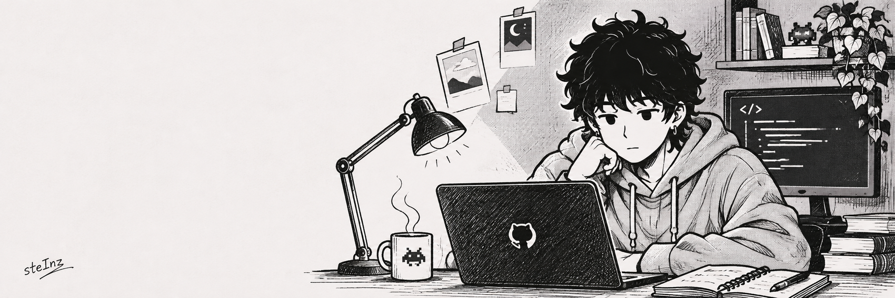

  

<h1 align="center">hey, i'm earhl. aka steinz</h1>

  Earhl Nash Dumaquita · 2nd-year BSIT at <b>National University Fairview</b> 
  <i>i make things because they sound fun. learning how they work is part of it.</i>

---

### 01 / a little about me

I'm Earhl, an IT student who likes turning random ideas into things you can actually click, try, or play with. I enjoy **vibe coding**, experimenting with interfaces, and building projects that are **entertaining first**. If they end up being useful too, that's a bonus.

I'm still figuring a lot of things out. I use AI to help me explore ideas, but I'm also working on understanding the code, spotting mistakes, and making the final result my own.

### 02 / tools on my desk

| Building & practicing | Learning & exploring |
| :--- | :--- |
| HTML, CSS & JavaScript | TypeScript |
| Git, GitHub & VS Code | React Native / mobile UI |
| Java & object-oriented programming | Cloud & virtualization basics |
| SQL & database design | Arduino / embedded systems |
| Responsive layouts & UI design | Testing & debugging habits |

*These are the tools and subjects I'm working with as a student—not a list of things I've mastered.*

### 03 / a chapter outside school

**AI Data Annotation Specialist · 5 months**

I spent five months working in AI data annotation. It gave me a closer look at the human work behind AI systems and why careful, consistent data matters.

### 04 / things i've put into the world

| Project | What it does |
| :--- | :--- |
| [**SkillSwap**](https://github.com/steInz02/SkillSwap) | A place to trade what you know for something you want to learn. |
| [**Palette Port**](https://github.com/steInz02/palette-port) | A little pixel-art color workbench with live edits and exports. |
| [**Foldline**](https://github.com/steInz02/Foldline) | Turn illustrated pages into a foldable, printable mini-zine. |
| [**Faderoom**](https://github.com/steInz02/Faderoom) | A tactile mixer for dividing group presentation time. |

### 05 / currently interested in

- Odd little websites with unexpected interactions.
- Mobile interfaces that feel playful and personal.
- Turning "what if i made this?" into a working prototype.
- Getting better at reading, testing, and explaining the code I write.

---

still learning. still making. probably starting another side project.

